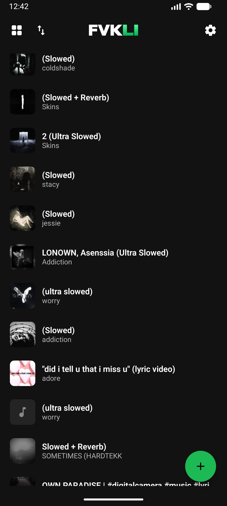
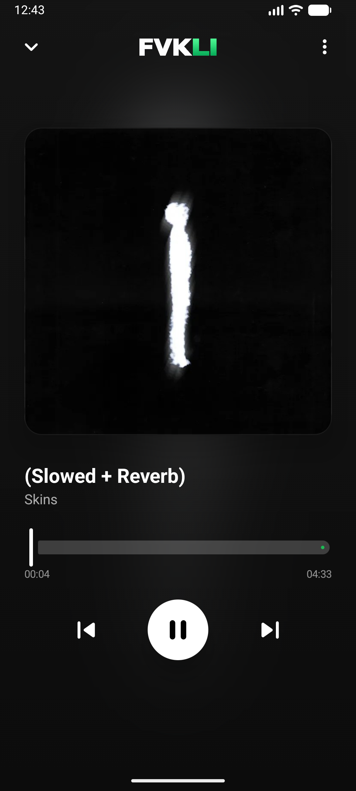
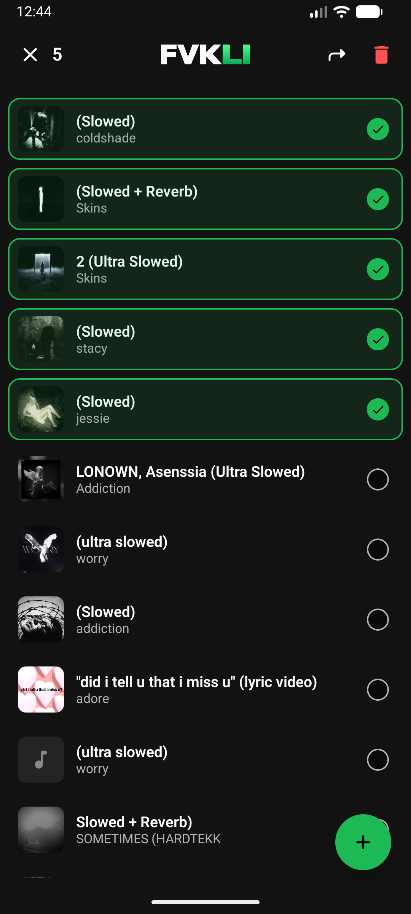
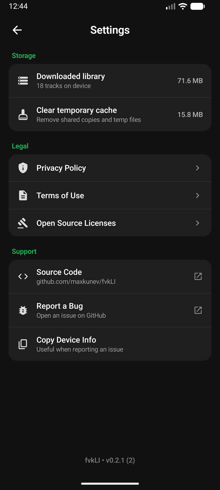

<p align="center">
  
</p>

<h1 align="center">LI (fvkLI) — Offline Android Music Player</h1>

<p align="center">
  <strong>Standalone, open-source Android music player and local YouTube / TikTok audio downloader.</strong><br/>
  No external servers. No subscriptions. Original audio quality stored directly on your device.
</p>

<p align="center">
  <a href="https://github.com/maxkunev/fvkLI/releases/latest">
    
  </a>
  
  
  
  
</p>

---

## Screenshots

<p align="center">
  
  
  
  
</p>

## Why LI?

Most music apps lock your library behind constant internet connections, paid subscriptions, or third-party cloud backends. **LI** runs 100% locally on your Android device using `yt-dlp` and `Media3`, keeping your music collection offline, private, and free of lossy re-encoding.

- **Zero Telemetry & No Backend:** Everything happens directly on your phone. No accounts, no tracking, no external APIs.
- **Native Audio Streams:** Saves original audio formats (`.opus`, `.m4a`, `.mp3`, `.webm`) without unnecessary transcoding.
- **System-Native Workflow:** Share links straight from TikTok or YouTube into LI, and export clean `Artist - Title` audio files back to any messenger.

## Features

### Audio Extraction & Sharing
- **One-Tap System Share Import:** Appears in Android's native **Share** sheet across YouTube, TikTok, SoundCloud, and browsers—automatically strips extra caption text and opens the download dialog ready to go.
- **Direct URL Download:** Paste any supported media link via the floating `+` button powered by `youtubedl-android` (`yt-dlp`).
- **Outgoing File Sharing:** Export single tracks via the long-press menu or batch-share multiple tracks in `Select` mode. Files are automatically formatted as `Artist - Title` via `FileProvider`.

### Playback & Gesture-Driven UI
- **Persistent Background Playback:** Built on Jetpack Media3 (`ExoPlayer` + `MediaSessionService`) with lock-screen controls, media notifications, headset button support, and continuous loop playback.
- **Full-Screen Player:** Expandable `PlayerScreen` featuring a swipeable cover carousel, interactive seek slider, quick metadata editing/deletion menu, and spring transitions.
- **Collapsible MiniPlayer:** Always-accessible bottom bar with track info, transport controls, and a custom cover-aligned close tab.

### Library & Storage Management
- **Flexible Browsing:** Switch between **List** and **Grid** layouts, sort your library, and use multi-select mode for batch sharing or deletion.
- **Smart Metadata Handling:** Automatically fetches cover art, splits raw video titles into `Artist` and `Title`, and lets you edit tags or replace artwork anytime.
- **Built-in Settings & Cache Control:** Track total library disk usage, clear temporary share caches in one tap, inspect open-source licenses, and copy device diagnostics for bug reports.

## Installation

1. Open the [**Latest Release**](https://github.com/maxkunev/fvkLI/releases/latest) page.
2. Download **`LI-v0.2.1.apk`** (or the latest APK) from the **Assets** section.
3. Open the downloaded file on your Android device (**Android 7.0 / API 24+**) and allow installation from unknown sources if prompted.

## Tech Stack & Architecture

| Layer | Technology | Purpose |
| :--- | :--- | :--- |
| **Language** | Kotlin | Core application logic and coroutines |
| **UI Framework** | Jetpack Compose (Material 3) | Declarative UI, custom shapes, and gesture animations |
| **Audio Engine** | Jetpack Media3 (`ExoPlayer`) | Background `MediaSessionService` and audio focus handling |
| **Media Extractor** | `youtubedl-android` (`yt-dlp`) | On-device stream extraction from YouTube, TikTok, etc. |
| **Image Loading** | Coil | Asynchronous cover art loading and memory caching |
| **Storage & Sharing** | Local JSON + `FileProvider` | Lightweight metadata persistence and secure URI file sharing |

## Roadmap

- [x] Offline YouTube & TikTok audio downloading without re-encoding
- [x] Jetpack Media3 background playback service & loop queue
- [x] Automatic cover art, MiniPlayer & swipeable full-screen PlayerScreen
- [x] Manual track metadata/cover editing, Grid/List views, sorting & batch selection
- [x] Direct downloading via Android **Share** menu from YouTube / TikTok
- [x] Outgoing single & batch audio file sharing (`Artist - Title`)
- [x] Settings screen with storage stats, cache cleaner & legal notices
- [ ] Custom playlists & queue reordering
- [ ] Instant library search & filtering
- [ ] Playback speed control & audio equalizer
- [ ] Local on-device AI for automatic metadata cleanup & lyrics/subtitles

## Building from Source

1. Clone the repository:
   ```bash
   git clone [https://github.com/maxkunev/fvkLI.git](https://github.com/maxkunev/fvkLI.git)
   ```
2. Open the project in **Android Studio** (Ladybug or newer recommended).
3. Wait for Gradle to sync dependencies and download the native `youtubedl-android` libraries.
4. Select the `app` run configuration and deploy to a physical Android device or emulator (`minSdk 24`).

## Disclaimer

**LI (fvkLI)** is an independent open-source project intended solely for personal, non-commercial use. Users are responsible for complying with local copyright laws and the Terms of Service of any third-party platforms from which they access content.

---

<details>
<summary>Keywords & Topics</summary>

`android-music-player` · `offline-music-player` · `youtube-audio-downloader` · `tiktok-audio-downloader` · `yt-dlp-android` · `youtubedl-android` · `jetpack-media3` · `exoplayer` · `jetpack-compose` · `kotlin-android` · `open-source-music-player` · `opus-player`
</details>
